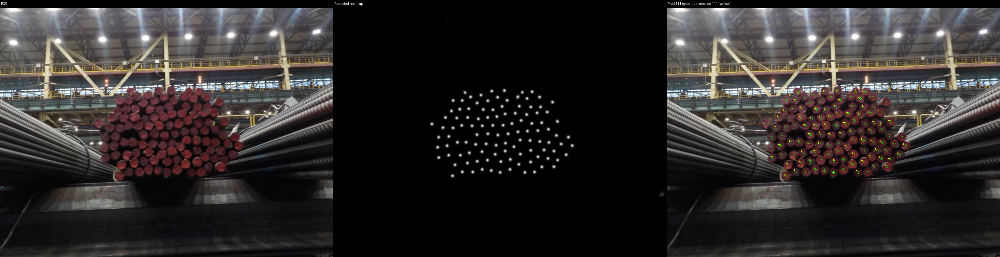

# Steel Rod Counting

Detect and count visible steel-rod ends using an ImageNet-pretrained ResNet-50 U-Net. Gaussian centre heatmaps are converted into rod-centre peaks and counts. The best recorded model achieved **8.05 rods/photo MAE** on 19 annotated test photos resized to 1024 x 768.

This submission includes source, the dataset ZIP, recorded results, a trained checkpoint, and commands for preparation, training and inference. The [technical report](TECHNICAL_REPORT.md) explains design choices, experiments and limitations.

## Included material

| Material | Location |
| --- | --- |
| Original dataset: images and point annotations | [dataset/segmentation_dataset.zip](dataset/segmentation_dataset.zip) |
| Best checkpoint, all 100 epochs of logs/HTML/previews, validation/test outputs | [Download best_run.zip](https://github.com/T0MAN1CK/steel-rod-counting/releases/download/v1.0.0/best_run.zip) |
| Training settings and epoch metrics | [results/run_config.json](results/run_config.json), [results/training_metrics.csv](results/training_metrics.csv) |
| Test metrics and counts per photo | [results/test_metrics.json](results/test_metrics.json), [results/test_counts.csv](results/test_counts.csv) |
| Validation metrics | [results/validation_metrics.json](results/validation_metrics.json) |

The checkpoint is distributed through a repository Release because it exceeds regular Git's per-file limit. The dataset ZIP and result summaries are committed to Git. Extracted data, new runs and generated outputs remain ignored.

## 1. Install the project

The reported training used **Python 3.13, PyTorch 2.11.0 + CUDA 12.8, torchvision 0.26.0 and an NVIDIA RTX 4060 Ti with 8 GB VRAM**. These describe the experiment; the same GPU is not required. CPU inference is supported. Full training currently uses CUDA, with a batch size that fits the available GPU.

From a VS Code PowerShell terminal:

```powershell
git clone https://github.com/T0MAN1CK/steel-rod-counting.git
cd steel-rod-counting

py -3.13 -m venv .venv
$python = Join-Path $PWD ".venv/Scripts/python.exe"
& $python -m pip install --upgrade pip

# CUDA build used for the reported training:
& $python -m pip install torch==2.11.0 torchvision==0.26.0 --index-url https://download.pytorch.org/whl/cu128
& $python -m pip install -e .
& $python -m pip check
& $python -c "import torch; print(torch.__version__); print('CUDA available:', torch.cuda.is_available())"
```

For **CPU-only evaluation**, replace the CUDA installation line with:

```powershell
& $python -m pip install torch==2.11.0 torchvision==0.26.0 --index-url https://download.pytorch.org/whl/cpu
```

Other NVIDIA systems can choose a compatible build using the [official PyTorch installer](https://pytorch.org/get-started/locally/). The packaged CUDA runtime is selected through the wheel; an identical graphics card is unnecessary. In VS Code, use **Python: Select Interpreter**. Set `$python` again in every new terminal.

Dependencies are pinned in [pyproject.toml](pyproject.toml): Python 3.12–3.13, PyTorch 2.11.0, torchvision 0.26.0, segmentation-models-pytorch 0.5.0, NumPy 2.5.2, SciPy 1.18.1 and Pillow 12.3.0. Linux users can create/activate a virtual environment and use `python` instead of `& $python`. The commands document the tested Windows workflow.

## 2. Extract the dataset and saved model

For a fresh clone:

```powershell
New-Item -ItemType Directory -Force data/raw | Out-Null
Expand-Archive -LiteralPath dataset/segmentation_dataset.zip -DestinationPath data/raw

Invoke-WebRequest -Uri "https://github.com/T0MAN1CK/steel-rod-counting/releases/download/v1.0.0/best_run.zip" -OutFile best_run.zip
Expand-Archive -LiteralPath best_run.zip -DestinationPath .

$checkpoint = "runs/sigma3/seed42_patience30_20261028_133154/best.pt"
```

Skip extraction if these files already exist. The dataset contains `data/raw/segmentation_dataset/train_data` and `test_data`, with their label JSON files. The model archive restores the original run directory, including `best.pt`, settings, epoch metrics, HTML pages and PNG previews. It also restores saved validation/test reports under `artifacts/`. No retraining is needed to run the supplied model.

Dataset ZIP SHA-256: `eb03a4b6e224caef4c4b39d9c3e4a8df9259bbad4c487a785072e5f81cd84110`.

## 3. Run inference on test data or new images

```powershell
$checkpoint = "runs/sigma3/seed42_patience30_20261028_133154/best.pt"
$prediction = "artifacts/predictions_$(Get-Date -Format yyyyMMdd_HHmmss)"

& $python -m rod_counting.inference $checkpoint --size 1024 768 --peak-threshold 0.65 --save-previews --output $prediction
if ($LASTEXITCODE -eq 0) { Invoke-Item $prediction }
```

Add **`--device cpu`** to run without CUDA.

Default input is `data/raw/segmentation_dataset/test_data`. **Put additional JPG, PNG or TIFF images directly in that directory and rerun the command to predict them too.** Use distinct filenames. New images do not need labels. For a separate folder, add `--data path/to/images`; optional reference annotations use `--labels path/to/labels.json`.

Outputs are `counts.csv`, `metrics.json` and one prediction PNG per image. Previews show RGB, heatmap and centre overlays: green circles are predictions, yellow crosses are available annotations. Unlabeled images receive counts/previews with blank reference/error fields. MAE/RMSE/bias use only labeled images and are `null` if none are labeled.

Inference processes each whole image in one forward pass. `--size 1024 768` specifies width then height. This working scale performs much better than native 4K input or shrinking an entire dense photo to 256 x 256. Every evaluation needs a fresh output directory.

### Visual result

Example: 111 predicted and 111 annotated rods. Panels show RGB, heatmap and predicted/reference centres.



A difficult example and error analysis are in the [technical report](TECHNICAL_REPORT.md#errors-and-limitations).

## 4. Prepare training data

The supplied archive already contains 256 x 256 training patches. For fresh preparation:

```powershell
& $python scripts/data_preparation/remove_black_patches.py --source data/raw/segmentation_dataset/train_data --output data/prepared/training_v1/train_data

& $python scripts/data_preparation/split_train_validation.py --train-dir data/prepared/training_v1/train_data --output data/prepared/training_v1/splits

& $python scripts/data_preparation/create_heatmaps.py --train-dir data/prepared/training_v1/train_data --splits data/prepared/training_v1/splits --output data/prepared/training_v1/heatmaps_sigma3 --sigma 3
```

These commands require new output directories. Skip them if data is already prepared. They remove only black unannotated padding, group by source photo before splitting, correct documented boundary coordinates and generate continuous float32 Gaussian TIFF targets. The result is **2,721 training patches and 673 validation patches**, preserving all 107,007 points. Validation is unaugmented. Original full training photos and their crop script are not supplied; preparation starts from the provided patches.

## 5. Train end-to-end

Run dependency/unit checks and no-update CUDA preflight:

```powershell
& $python -m pip check
& $python -m unittest discover -s tests -v
& $python -m rod_counting.train --check-only --heatmaps data/prepared/training_v1/heatmaps_sigma3 --batch-size 8 --seed 42 --peak-threshold 0.5 --stretch 0 --zoom 0
```

Preflight checks finite forward/backward behavior without an optimizer step or checkpoint; it does not prove convergence or optimizer-state memory fit. Start training separately:

```powershell
$run = "runs/sigma3/patches_sigma3_seed42_thr050_pat30_$(Get-Date -Format yyyyMMdd_HHmmss)"

& $python -m rod_counting.train --data data/prepared/training_v1 --heatmaps data/prepared/training_v1/heatmaps_sigma3 --batch-size 8 --seed 42 --peak-threshold 0.5 --stretch 0 --zoom 0 --patience 30 --epochs 100 --run-dir $run
```

This is the supplied best run's configuration: ImageNet-pretrained ResNet-50 U-Net, weighted MSE alpha 10, AdamW with learning rate/weight decay both 0.0001, CUDA AMP, batch 8, sigma 3 and seed 42. Paired flips/90-degree rotations and RGB-only brightness/contrast/colour changes are enabled. Optional zoom/stretch are off. Batch size affects optimization; reduce it if GPU memory requires it and record the difference.

Checkpoint selection minimizes validation **count MAE** at threshold 0.5. Training gradients come from continuous heatmap MSE. Training stops after 30 stale epochs with minimum improvement 0.001, or at 100 epochs. `best.pt` is the lowest-MAE checkpoint; `last.pt` is the latest. The supplied run selected epoch 83. Saved-model evaluation uses threshold 0.65. Gaussian sigma controls target width and is not a score threshold.

Open the printed `progress.html` after the first epoch, or run `Invoke-Item "$run/progress.html"`. It refreshes with charts and fixed validation examples. Each run saves all epoch pages, PNGs, CSV/JSONL metrics, settings and environment details. Use new run directories. Interrupted-run resume is not implemented. Different runtimes need not produce identical weights.

## 6. Evaluate validation performance

After preparing data in step 4:

```powershell
$checkpoint = "runs/sigma3/seed42_patience30_20261028_133154/best.pt"
& $python -m rod_counting.test $checkpoint --peak-threshold 0.65 --output "artifacts/validation_$(Get-Date -Format yyyyMMdd_HHmmss)"
```

Add `--device cpu` if needed. Outputs include metrics and fixed validation PNGs. The supplied model achieves patch MAE **1.5082**, RMSE **2.8261** and point F1 **0.9438** at threshold 0.65. Test MAE is **8.0526**, RMSE **9.4618**, bias **+2.8947 rods/photo**. Patch and photo MAE have different units. The test images were repeatedly inspected, so these are exploratory comparisons rather than an unseen-test estimate.

## Code organization and experiments

| Responsibility | File under `src/rod_counting/` |
| --- | --- |
| CLI settings and seeds | `config.py` |
| Samples and loaders | `dataset.py`, `dataloader.py` |
| Augmentation and targets | `augmentation.py`, `heatmaps.py` |
| Model and loss | `model.py`, `losses.py` |
| Training and validation | `train.py`, `validation.py` |
| Counts and point matching | `metrics.py` |
| Local HTML, PNG and logs | `reporting.py` |
| Evaluation, inference, preflight | `test.py`, `inference.py`, `test_loader.py` |

Preparation scripts are under `scripts/data_preparation/`; `scripts/compare_runs.py` compares metrics/settings. Use `& $python -m rod_counting.train --help` for arguments. Separate `--heatmaps` and `--run-dir` paths preserve experiments. The [report](TECHNICAL_REPORT.md#experiments-and-comparisons) documents sigma, seed, threshold, patience, zoom/crop, scene training and scene-validation experiments.

Different learning rates were also tested during hyperparameter tuning. The retained configuration, with learning rate `0.0001`, gave the best observed overall outcome among the configurations tried. Limited GPU resources and available time restricted the search; this was a small experimental comparison, not an exhaustive search for optimal hyperparameters.

## AI tools

I used AI for research, to set up the environment for GPU training, and to make modifications to the source code during development. AI-assisted changes and recommendations were checked through dependency checks, unit tests, CPU/CUDA preflight checks, validation and inference metrics, and visual inspection of prediction overlays.
