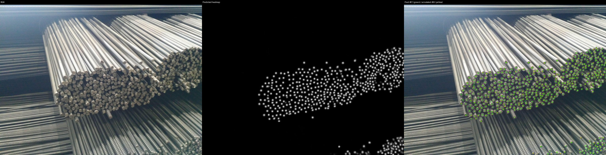

# Technical report: steel-rod localization and counting

## Problem and practical use

The task is to count visible rod ends in stacked-steel photographs and show where they are located. A count can hide missed rods and false detections, so the system also produces centre overlays and heatmaps. It is an inspection aid, with visual review of ambiguous detections rather than a guarantee of physical inventory accuracy.

The practical interface accepts a folder of new images, predicts counts, saves overlays and optionally compares results with point labels. Installation and full commands are in the [README](README.md).

## Data and preparation decisions

The archive supplies 4,573 training patches of 256 x 256 and 19 test photos of 4160 x 3120, with JSON centre annotations. Individual rod-end points provide suitable supervision for dense counting. They do not describe boundaries, so ordinary boundary segmentation would not match the available labels.

Training patches were already present in the dataset; original full training photos and the cropping implementation are unavailable. Preparation starts from those patches. Removing the final `_patch-index` recovers the photo group. Groups are split before augmentation, preventing neighboring patches of the same photo from crossing splits.

Only all-black, unannotated patches with padding suffixes 12–15 are removed: 1,179 patches. Annotated/nonblack patches are preserved. Coordinates equal to 256 are mapped to 255 only on an actual 256-pixel dimension, in prepared split files. Raw labels stay unchanged; 19 boundary coordinates are corrected.

| Split | Photo groups | Images | Points |
| --- | ---: | ---: | ---: |
| Training | 235 | 2,721 | 84,257 |
| Validation | 59 | 673 | 22,750 |
| Test | 19 | 19 full photos | 8,279 |

There are 762 empty retained patches, including 136 in validation, providing examples where nothing should be detected. Counts come from annotations, not target components. Split seed 42 is fixed independently of training seed.

### Reconstructing scenes

A separate experiment joins complete groups of twelve patches into 1024 x 768 scenes, using four columns and three rows in row-major order. Seam checks supported this layout and representative reconstructions were visually inspected. For patch index `i`:

```text
global_x = local_x + (i % 4) * 256
global_y = local_y + (i // 4) * 256
```

Targets are regenerated from translated centres. Incomplete groups retain individual patches; missing content is never synthesized. This yields 240 scenes plus 514 patches with every original point/split retained: 194 scenes + 393 patches for training, and 46 scenes + 121 patches for validation.

This supplies more context at a similar rod scale. It also changes batch size, sample weighting and optimizer-update frequency, so it is not a context-only comparison.

## Model and loss

The model is a U-Net with an ImageNet-pretrained ResNet-50 encoder, skip connections and one output-logit channel, supplied by `segmentation-models-pytorch`. Pretraining provides visual features; the decoder learns spatial localization. Both are trained. RGB inputs use ImageNet normalization without classification cropping.

Each annotation creates a Gaussian target peaking at 1 at an integer centre. Overlaps use the maximum of the Gaussians. Float32 TIFF preserves continuous values; PNG/HTML previews are viewable. These are localization maps, not binary boundaries or unit-mass density maps.

The weighted loss is:

```text
mean((1 + 10 * target) * (sigmoid(logits) - target)^2)
```

This emphasizes sparse foreground targets over background. Loss arithmetic stays float32 with CUDA AMP. Dice/IoU measure constructed region overlap rather than directly count centres. Thresholded peaks are nondifferentiable, and summing these maximum-combined targets is not a valid count loss. A differentiable count objective would require a different formulation.

## Training and evaluation

The preferred configuration uses AdamW, learning rate/weight decay 0.0001, batch 8, seed 42, sigma 3, maximum 100 epochs and patience 30. Augmentation pairs flips/90-degree rotations and applies RGB-only brightness/contrast/colour variation from 0.9 to 1.1. Validation is unaugmented; optional zoom/stretch are off.

Counts use 3 x 3 local maxima meeting the score threshold, collapse equal-score plateaus and suppress lower peaks within 3 pixels. Precision/recall/F1 use maximum-cardinality one-to-one point matching within 5 pixels.

Training minimizes heatmap MSE; checkpoint selection minimizes validation count MAE. Selection threshold is 0.5; saved-model evaluation uses 0.65. A threshold change can affect selected epoch/early stopping without directly changing loss gradients. The final checkpoint is epoch 83. Improvements exceeding 0.001 reset patience; smaller improvements can still update `best.pt`.

Inference resizes each whole photo to 1024 x 768 and runs one forward pass, padding to multiples of 32 when necessary. It does not tile photos. New images need no labels; error metrics use only inputs with reference annotations.

## Experiments and comparisons

Experiments preserve photo grouping and use separate targets/runs. Sigma-2 training used threshold 0.3; sigma-3 used 0.5. Both settings changed, so this does not isolate width alone. The sigma-2 checkpoint had validation patch MAE 2.2571 at 0.3 and 1.6360 when re-evaluated at 0.5. No full-photo test result is claimed for that checkpoint.

Results below use the same 19 photos at 1024 x 768 and threshold 0.65 except where stated.

| Experiment | Best epoch | Test MAE | Test RMSE |
| --- | ---: | ---: | ---: |
| Sigma 3 patches, seed 42, patience 15 | 62 | 8.6842 | 11.3994 |
| Sigma 3 patches, seed 43, patience 15 | 32 | 9.6316 | 12.3267 |
| Sigma 3 patches, seed 43, patience 30 | 100 | 9.1579 | 12.9371 |
| Sigma 3 patches, seed 42, patience 30 | 83 | **8.0526** | **9.4618** |
| Sigma 3 patches, zoom 0.2, seed 42 | 25 | 10.9474 | 14.8288 |
| Reconstructed scenes + patches, batch 1 | 31 | 19.6842 | 29.5083 |
| Patch training / scene validation, seed 43, threshold 0.6 | 3 | 17.7895 | 21.7643 |

Longer patience on the seed-42 setup reduced observed MAE by **7.3%** and RMSE by **17.0%**. This improves counting quality; it does not establish faster inference or a statistically proven population gain. A controlled AMP speedup and quantization/compression performance have not been measured.

Seed variation changed initialization, sample order and augmentation. More scene context did not improve the tested configuration, which also changed batching and weighting. Zoom/crop did not improve the tested run. Selecting on full scenes chose an early checkpoint and performed worse in this experiment. These findings do not prove those approaches can never help.

### Threshold and scale

The seed-42, patience-15 model had validation MAE 1.7667 at threshold 0.5, 1.5245 at 0.6 and 1.5052 at 0.65. Raising a threshold removes weak false peaks and weak true rods; lowering it can add both. Seed 43 with patience 15 had test MAE 9.6316 at 0.65 versus 12.7368 at 0.6, so a lower threshold was not universally better.

For seed 42 with patience 15, native 4K inference at 0.65 gave MAE 324.3158, whole-photo 256 x 256 gave 295.6842, and 1024 x 768 gave 8.6842. Patch dimensions should not be confused with an appropriate whole-scene resize. These checks exposed sensitivity to apparent rod size.

The test set was repeatedly examined, so these are exploratory comparisons. An untouched capture-session test set is needed for an unbiased estimate. No significance claim is made from 19 photos. Changes in sigma/threshold, batch, sample units and selection policies are stated rather than presented as fully isolated comparisons.

### Reproduce alternatives

Start with the README training command, use a fresh `--run-dir`, and change the intended setting:

- **Sigma:** generate a separate target root with `create_heatmaps.py --sigma 2` or another width; select it with `--heatmaps`. The original sigma-2 run used threshold 0.3 and patience 15.
- **Seed/patience:** use `--seed 43`, `--patience 15` or `--patience 30`, holding other settings fixed.
- **Zoom/crop:** `--zoom 0.2 --stretch 0` applies uniform 0.8–1.2 scaling to 50% of patches, with random crop/padding. Centres transform and fixed-sigma targets regenerate. Validation stays unchanged.
- **Stretching:** `--stretch 0.15 --zoom 0` compresses axes independently and centre-pads RGB/targets. It is optional, not the final configuration; no separate measured result is claimed.

Prepare reconstructed scenes in a new output root:

```powershell
& $python scripts/data_preparation/reconstruct_scenes.py --data data/prepared/training_v1 --output data/prepared/larger_scenes_v1
& $python scripts/data_preparation/create_heatmaps.py --train-dir data/prepared/larger_scenes_v1/train_data --splits data/prepared/larger_scenes_v1/splits --output data/prepared/larger_scenes_v1/heatmaps --sigma 3
```

Train on scenes plus leftover patches:

```powershell
& $python -m rod_counting.train --data data/prepared/larger_scenes_v1 --batch-size 1 --seed 42 --peak-threshold 0.65 --stretch 0 --zoom 0 --patience 15 --epochs 100 --run-dir "runs/larger_scenes/experiment_$(Get-Date -Format yyyyMMdd_HHmmss)"
```

Batch 1 accommodates mixed dimensions and rectangular rotations. Selection MAE averages 46 validation scenes and 121 patches; separate scene/patch metrics are logged.

For patch training with selection on the 46 complete validation scenes:

```powershell
& $python -m rod_counting.train --data data/prepared/training_v1 --heatmaps data/prepared/training_v1/heatmaps_sigma3 --validation-scenes data/prepared/larger_scenes_v1 --batch-size 8 --seed 43 --peak-threshold 0.6 --stretch 0 --zoom 0 --patience 30 --epochs 100 --run-dir "runs/patch_train_scene_val/experiment_$(Get-Date -Format yyyyMMdd_HHmmss)"
```

Each complete validation scene is evaluated at batch 1; all 673 patch metrics are logged separately under `patch_val/*`. Without this flag, patch validation remains unchanged. Patch, mixed-sample and photo MAE have different units.

## Final results

For epoch 83 of the seed-42, sigma-3, patience-30 run, evaluated at threshold 0.65:

| Metric | Validation patches | Test photos |
| --- | ---: | ---: |
| Count MAE | 1.5082 | 8.0526 |
| Count RMSE | 2.8261 | 9.4618 |
| Count bias | +0.0461 | +2.8947 |
| Point precision | 0.9432 | Not reported as a final test metric |
| Point recall | 0.9445 | Not reported as a final test metric |
| Point F1 | 0.9438 | Not reported as a final test metric |

The model predicts 8,334 rods against 8,279 labels. Total error is not MAE: overcounts/undercounts can cancel. The largest absolute photo error is 20 rods. Exact counts/settings are in [results/](results/); the release contains full logs/previews.

## Errors and limitations

Shaft highlights, ribs and partial side surfaces can resemble ends. Small, dim, occluded and border-adjacent ends can be missed. A global threshold suppresses both weak false peaks and weak real rods. Merging nearby blobs risks joining distinct adjacent rods. No semantic shaft correction or automatic relabeling was applied.

Labels can be incomplete or offset from predictions. An unmatched visible prediction is not automatically false; a tight tolerance can penalize an offset on the same face. Correct counts can conceal misses and false detections that cancel. Inspect overlays alongside metrics.

This difficult example predicts 481 against 495 labels, error -14, on an angled dense stack:



Filename grouping does not establish capture-session independence; related captures under different names remain possible. Reconstruction relies on seam evidence rather than an original crop specification. The archive has no supplied source URL or license information; none is invented here.

The approximately 373 MiB checkpoint includes optimizer/scaler state and is larger than a model-only export. Loading it needs no ImageNet download. Evaluation supports CPU/CUDA; full training is CUDA-only. Preflight checks finite computation, not convergence or optimizer memory fit.

## Verification and future work

Tests cover augmentation alignment, float targets, loss gradients, peaks/matching, photo isolation, reconstruction offsets, checkpoint decisions, reports, unlabeled inference and mixed folders. Real CPU/CUDA inference reproduced saved test counts; no-update CUDA preflight passed. Reviewing the supplied model needs no full training.

Strengths are leakage-aware grouping, focused modules, point-supervised counting, preserved settings and local visual reports. Weaknesses are scale sensitivity, shaft/end ambiguity, possible label issues and limited independent evaluation.

Priorities are auditing ambiguous training/validation labels, verified shaft-only hard negatives, untouched session-level evaluation, more seeds with fixed settings and validation-based scale comparisons. Model-only export, measured latency/memory comparisons, smaller encoders and quantization are possible deployment improvements. New losses/merging rules need controlled evaluation.

## AI tools

I used AI for research, to set up the environment for GPU training, and to make modifications to the source code during development. AI-assisted changes and recommendations were checked through dependency checks, unit tests, CPU/CUDA preflight checks, validation and inference metrics, and visual inspection of prediction overlays.
